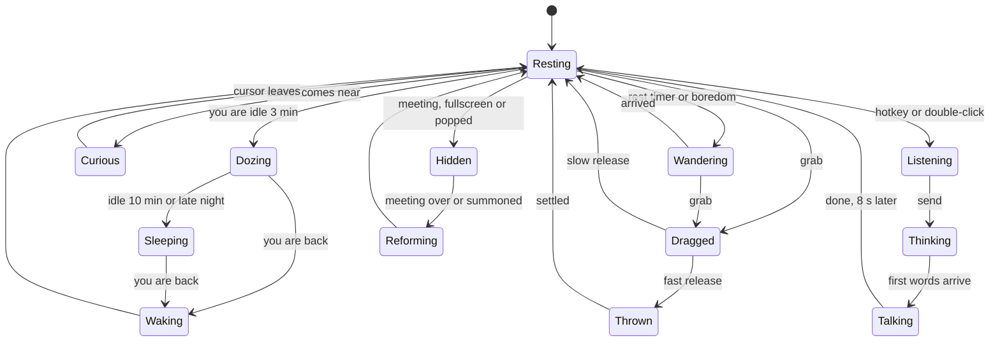
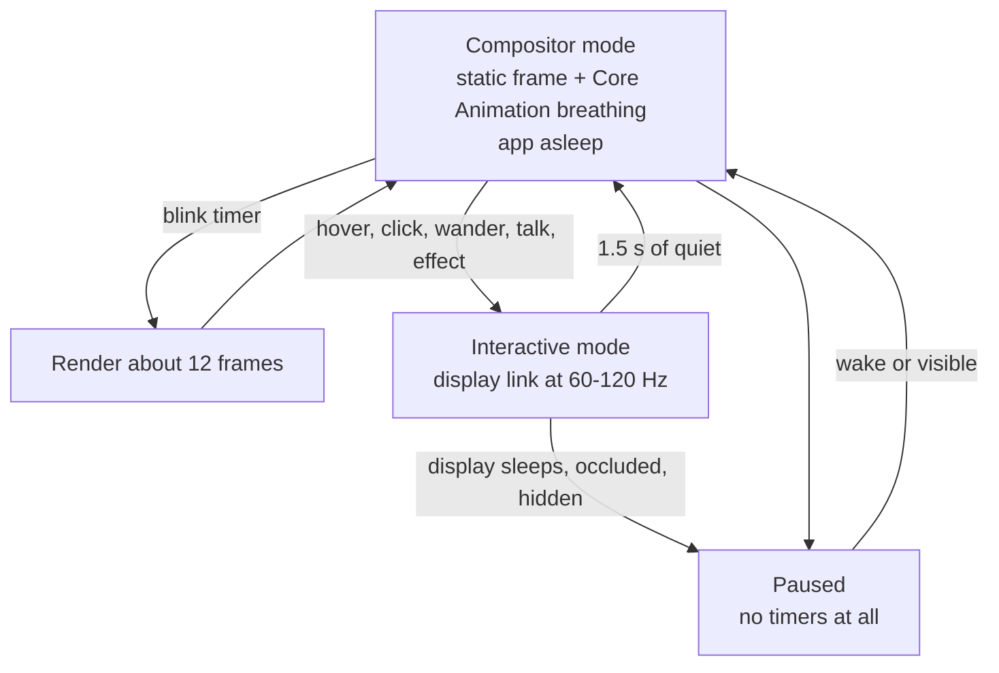
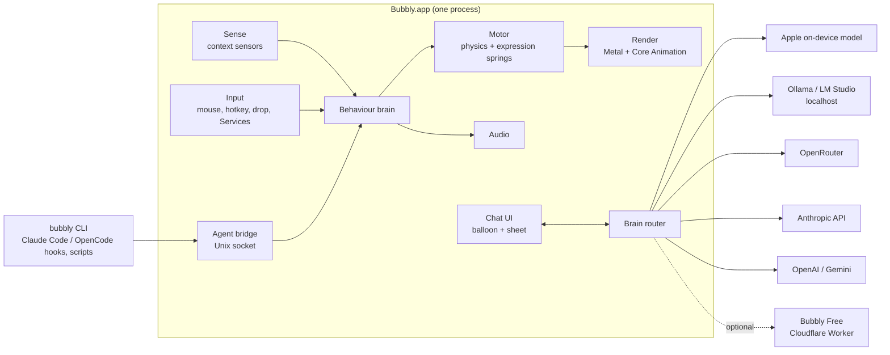
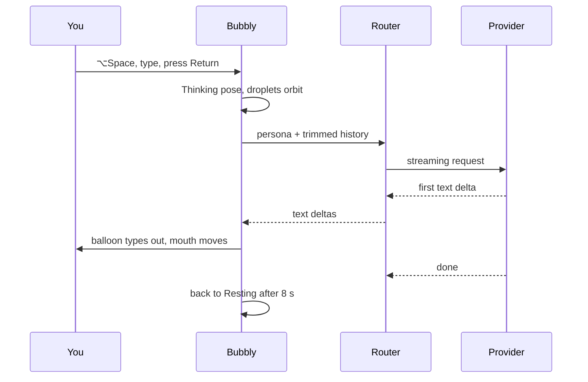
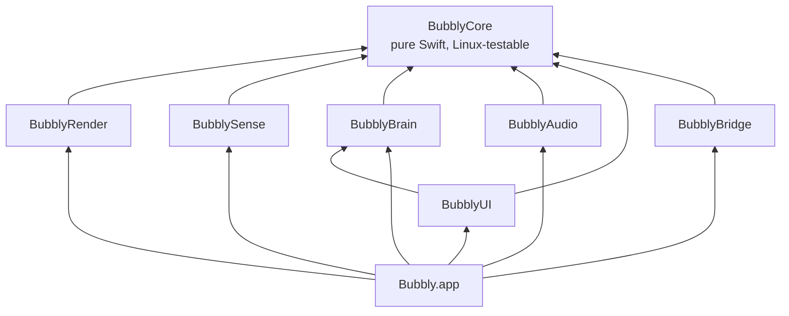

# Bubbly v2: design from scratch

> **Status:** proposal. Nothing here is implemented yet.
> **Date:** 2 November 2026
> **For:** whoever builds Bubbly v2, a person or an AI coding agent.
> **How it was written:** I read every file of the current repo (Swift app, Cloudflare Worker, landing page), then set it aside and designed the product as if I'd only been given the idea. The current code shows up only in [Appendix A](#appendix-a--lessons-from-v1), to explain why some decisions go the way they do.

---

## 0. Summary

| | Decision |
|---|---|
| **Idea** | A tiny living companion that floats on your Mac. It keeps you company, nudges you gently, and becomes a quick helper the moment you ask. |
| **Character** | Keep **Bubbly the soap bubble**, rebuilt as a fully procedural character: no image files. One Metal shader draws the membrane, the iridescent soap film and the face. |
| **Feel** | Physics instead of tweens. One display-synced clock, spring-driven expressions, soft-body wobble, eyes that follow your cursor, throwable, sleeps when you're away. |
| **Performance** | "The compositor does the idle work; the app wakes only to interact." Targets: about 0% CPU at rest, ≤3% while wandering, ≤60 MB RAM, smooth at 120 Hz. |
| **AI ("the brain")** | **Works with no server.** Defaults: Apple's free on-device model, a one-click **Connect OpenRouter** login, your own API keys (Anthropic, OpenAI, Gemini), or a local model (Ollama, LM Studio). A hosted free tier is optional. |
| **Claude Code login** | **Not allowed.** Anthropic's terms forbid third-party apps from using Claude Free/Pro/Max logins. Instead, Bubbly becomes a **companion for Claude Code, OpenCode or any terminal command** through hooks: it tells you when your agent finishes or needs you. |
| **Engineering** | A pure-Swift core that also compiles on Linux, so cloud CI and cloud agents can test it, plus thin macOS adapters. CI runs on GitHub macOS runners, which are free for this public repo. |

---

## 1. The idea, distilled

### 1.1 What Bubbly does for people

1. **Company.** The screen feels a little alive. Something small notices you, reacts to you, and is pleased when you come back.
2. **Ambient awareness.** Gentle physical nudges instead of notification banners: a timer is done, your coding agent finished, you've been at it for two hours.
3. **Instant help.** Ask a quick question, or drop some text on Bubbly to summarise or translate it, without opening a browser tab.

### 1.2 What Bubbly is not

- Not a full chat app. Long work belongs in the user's main assistant.
- Not a productivity suite. Bubbly has no to-do list or calendar.
- Not a spy. It never reads the screen, records keystrokes, reads window titles, or listens through the microphone.

### 1.3 Design principles

These settle arguments later.

1. **Alive, not busy.** Motion is continuous and organic but small. It never competes with your work.
2. **Polite.** It gets out of your way, hides during meetings and fullscreen, and never steals keyboard focus unless you ask it to.
3. **Free when idle.** When nothing is happening it costs almost nothing. Battery life is a feature.
4. **One character with depth beats many shallow options.**
5. **Local first.** It works offline. Nothing leaves the Mac unless you send it.
6. **Every pixel is procedural.** No sprite sheets or PNG characters. It looks sharp at any size and uses almost no memory.
7. **Honest AI.** It uses the provider *you* picked, says which one if asked, and shows exactly what gets sent.

---

## 2. The character

### 2.1 Why keep the bubble

I compared the realistic options for a floating desktop companion:

| Candidate | Needs a "floor"? | Lets you see your work through it? | Expressive without limbs? | Procedural render cost | Art cost | Fits the "Bubbly" brand |
|---|---|---|---|---|---|---|
| **Soap bubble** | No, it floats | **Yes, it's translucent** | **Yes: squash, wobble, eyes** | Low (one shader) | None | **Perfect** |
| Cat / dog | Yes (walks on the Dock or window tops) | No | Needs a rig (ears, tail, paws) | High | High (artist plus rig) | Weak |
| Slime / blob | Yes, it sits | Partly | Yes | Low | Low | Weak |
| Ghost | No | Partly | Yes | Low | Low | Off-brand (spooky) |
| Jellyfish | No | Yes | Tentacles are hard to make cute | Medium | Medium | Weak |

The deciding fact is that **a desktop has no floor**. Walking characters need surfaces, so you end up writing endless collision code, and they look wrong in mid-air. A bubble floats naturally, it's see-through so it never fully covers your work, and bubbles come with built-in verbs no other character has: **float, wobble, squash, split, merge, pop, re-form, blow tiny bubbles.** All of those become interactions and effects that fit together.

**Decision:** keep Bubbly the bubble and drop Cat and Dog as separate characters. If an artist joins later, add *costumes* (ears or a hat drawn in the shader) or a small *inhabitant* floating inside the bubble, animated with Rive. Rive's Apple runtime supports macOS 13.1+ and state machines.

### 2.2 Visual spec

One fragment shader draws everything, in this order:

1. **Membrane.** A circle whose radius is modulated by low-order wobble modes (§3.1). The centre is mostly transparent (alpha about 0.15–0.35), so your desktop shows through.
2. **Soap film (iridescence).** A film-thickness field made from slow-flowing noise, plus gravity drainage: real soap films are thinner at the top, which shows as gold and magenta bands up there and blue and green lower down. Colour comes from thickness and viewing angle through a cheap interference palette ([Appendix B](#appendix-b--shader-sketch)). The film swirls slowly over time.
3. **Fresnel rim.** Brighter and more colourful at the edge, like a real bubble seen from the side.
4. **Highlights.** Two specular "window reflections", a soft rounded rectangle and a small dot. They shift slightly *against* the direction of motion, which sells the 3D shape.
5. **Face.** The eyes carry almost all of the emotion: dark glossy ellipses with one or two catchlights, plus upper and lower lids, pupil size and gaze direction. The mouth is a single stroke whose curve morphs between smile, flat, "o" and wavy. Blush is a soft pink ellipse whose opacity is a parameter.
6. **Separation from the wallpaper.** A soft shadow that drifts further away the higher Bubbly is floating. With *Increase Contrast* on, a 1.5 pt outline is added.

**Backdrop.**
- On **macOS 26+**, the body can sit on `NSGlassEffectView` (Liquid Glass), so it genuinely refracts the desktop behind it.
- On **macOS 14–15**, use `NSVisualEffectView` with behind-window blur, masked to the body shape.
- With *Reduce Transparency* on, draw a solid tinted body.

Glass is optional: see the risk in §11.

**Options:** a continuous **hue** (the shader takes a single hue value; default sky blue, about 205°), **size** S/M/L (96/120/150 pt diameter, default 120 pt), **Glass or Solid**, and **shimmer amount**.

### 2.3 Expression system

Every expression is a point in a small parameter space. Each parameter is driven by its own spring toward a target, so **any expression blends smoothly into any other, even mid-transition.**

Parameters: `eyeOpen, lowerLid, lidTilt, pupil, gazeX, gazeY, mouthCurve, mouthOpen, mouthWave, blush, squashBias`.

These are starting values to tune on a real Mac:

| Emotion | eyeOpen | lowerLid | lidTilt | pupil | mouthCurve | mouthOpen | blush | Extra |
|---|---|---|---|---|---|---|---|---|
| neutral | 1.00 | 0.00 | 0.0 | 0.50 | +0.3 | 0.00 | 0.0 | — |
| happy | 0.85 | 0.35 | 0.0 | 0.55 | +0.8 | 0.10 | 0.2 | — |
| delighted (boop) | 0.30 | 0.80 | 0.0 | 0.60 | +1.0 | 0.40 | 0.5 | squint "^^" |
| curious | 1.10 | 0.00 | +0.1 | 0.70 | +0.1 | 0.15 | 0.0 | head-tilt via squashBias |
| surprised | 1.25 | 0.00 | 0.0 | 0.35 | 0.0 | 0.60 | 0.0 | pupils shrink |
| sleepy | 0.35 | 0.10 | −0.2 | 0.50 | +0.1 | 0.00 | 0.0 | slow breathing |
| shy | 0.80 | 0.25 | 0.0 | 0.60 | +0.4 | 0.00 | 0.8 | gaze down and to the side |
| focused | 0.75 | 0.15 | +0.2 | 0.45 | 0.0 | 0.00 | 0.0 | still |
| thinking | 0.90 | 0.10 | 0.0 | 0.50 | −0.1 | 0.00 | 0.0 | gaze up-left, mouthWave 0.6 |
| love (petted) | 0.40 | 0.70 | 0.0 | 0.70 | +0.9 | 0.05 | 1.0 | hearts |
| sad | 0.80 | 0.00 | −0.4 | 0.60 | −0.6 | 0.00 | 0.0 | — |

Layered on top of whichever emotion is active:

- **Blinks.** Random gaps of 2–6 s, a 15% chance of a double blink, 110 ms to close and 170 ms to open. The asymmetric easing is what makes a blink look organic.
- **Saccades.** The gaze jumps to a new point every 0.5–2 s with a tiny overshoot.
- **Breathing.** A slow scale oscillation of 1.5–2.5%, slower when sleepy.

---

## 3. Motion, behaviour and interaction

### 3.1 Physics model

- **Body.** A point with position and velocity, integrated at a fixed **240 Hz** with semi-implicit Euler and drawn at the display rate with interpolation. The forces are steering (from the brain), air drag, soft repulsion near screen edges, and the cursor while dragging.
- **Soft body.** The membrane is described by three wobble modes:
  `r(θ) = R · (1 + a₂·cos 2(θ−φ₂) + a₃·cos 3(θ−φ₃) + a₄·cos 4(θ−φ₄))`
  - Each `aₙ` is a damped oscillator kicked by acceleration (inertia) and by impacts: a boop at a point, or a bounce off a screen edge.
  - `n = 2` gives squash and stretch along the motion; `n = 3` and `n = 4` give the jelly wobble after a boop.
  - Normalise `R` to keep the area constant, so volume is preserved.
  - That's about 10 floats sent to the shader per frame.
- **Squash and stretch rule.** Stretch along the velocity by `s = 1 + k·|v|`, capped at 1.18, and shrink the perpendicular axis by `1/s`.
- **Follow-through.** The face trails the body on its own spring and the highlights counter-move, so stopping looks like a soft wobble-settle instead of a hard stop.
- **Springs.** Use the closed-form damped harmonic oscillator for each step. It's stable at any frame time and is parameterised the same way SwiftUI springs are: *response* (seconds) and *damping ratio*. Starting values:

| Channel | Response (s) | Damping ratio | Feel |
|---|---|---|---|
| Drag follow (body → cursor) | 0.10 | 0.90 | tight but alive |
| Wander velocity smoothing | 0.60 | 1.00 | calm and floaty |
| Mode a₂ (squash) | 0.35 | 0.35 | jelly |
| Modes a₃ / a₄ (wobble) | 0.22 / 0.16 | 0.25 | jiggle |
| Gaze | 0.08 | 0.75 | quick, with a tiny overshoot |
| Expression parameters | 0.25 | 0.85 | smooth blend |
| Face lag | 0.18 | 0.60 | follow-through |

The **personality slider** (§7) scales these: *Playful* lowers damping by about 20% and *Calm* raises it by about 20%.

### 3.2 Getting around

- **Wander.** Reynolds-style *wander* plus *arrive* steering. This produces natural arcs that slow down into a rest, instead of fixed Bézier paths. Rests last 4–20 s, weighted by personality. While resting, Bubbly sometimes looks around without moving.
- **Polite target choice.** At each rest, sample about 50 candidate spots and score them:
  - **−** near your recent cursor activity (a decaying 60-second heat map of where you've been working)
  - **−** overlapping the frontmost window's top 80 pt (toolbars and tabs)
  - **−** overlapping the menu bar or Dock
  - **+** near edges and corners ("home" spots)
  - **+** places it hasn't visited recently
  - **−** travel distance
  Take the best one. This is a microsecond-scale computation.
- **Perching** (delight). Occasionally Bubbly lands on the top edge of the frontmost window, as if on a shelf, and rides along if the window moves. While perched, window bounds are polled once per second. Bounds don't require Screen Recording permission; window titles would, and Bubbly never reads them.
- **Throw.** Drag and release fast, and Bubbly flies with air drag but no gravity, since it floats. It bounces off screen edges with an impact squash and a "bonk", then calms down.
- **Summon.** The hotkey makes Bubbly crouch slightly (anticipation), then arc over to your cursor.
- **Multiple displays.** Bubbly stays on its current display. It only changes display when you drag, throw or summon it there.

### 3.3 Behaviour brain

The brain has five layers:

1. **Sensors** read the context.
2. **Needs and mood**: three slowly changing values, *energy*, *sociability* and *boredom*.
3. **Utility selection**: each behaviour scores itself; the highest score wins, with hysteresis and minimum durations so Bubbly doesn't flicker between behaviours.
4. **Behaviours** (the states below).
5. **Motor**: steering forces and expression targets.



**Sensors.** None of these needs a permission prompt:

| Sensor | API | How often | Used for |
|---|---|---|---|
| You're idle or back | `CGEventSource.secondsSinceLastEventType` (any input; a counter, never content) | every 5 s | doze, sleep, wake-up stretch |
| Cursor | `NSEvent.mouseLocation` | per frame only when near; 4 Hz otherwise; 0 when asleep | eye tracking, curiosity, heat map |
| Frontmost app and fullscreen | `NSWorkspace` notifications plus `CGWindowListCopyWindowInfo` **bounds only** | on change, or 1 Hz while perched | polite targeting, fullscreen hiding |
| In a meeting | CoreMediaIO "device is running somewhere" (camera) and CoreAudio "device is running somewhere" (microphone) | property listeners, no polling | fade out and mute |
| Power and heat | `ProcessInfo.isLowPowerModeEnabled`, `thermalState`, `NSWorkspace` sleep/wake | notifications | energy rules (§4.5) |
| Accessibility | `NSWorkspace` reduce motion, reduce transparency and increase contrast | notifications | motion, glass and outline |
| Time of day | clock | per minute | sleepy at night, perky in the morning |

There is **no reliable API to detect screen sharing.** Setting `sharingType = .none` no longer reliably hides a window from ScreenCaptureKit on macOS 15+. So use camera-in-use as the main meeting signal and offer a manual **Hide while presenting** toggle. Don't promise anything stronger.

### 3.4 Interactions

| Gesture | What Bubbly does |
|---|---|
| **Hover** (cursor within 2× radius) | Eyes track the cursor and the body leans toward it slightly. On *Playful*, a fast-approaching cursor gets a small startled dodge. |
| **Click (boop)** | The membrane wobbles from the exact point you clicked (the click angle sets which way it wobbles), Bubbly squints happily, and the boop sound plays with random pitch. Repeated boops escalate: giggle, then dizzy (spiral eyes for a second). |
| **Petting** (move the cursor back and forth over it three or more times within 1.5 s, without clicking) | Blush, a purr sound, and floating hearts. |
| **Drag** | Bubbly grabs at the click point and the membrane stretches toward the cursor. A **4 pt threshold** separates a drag from a click, so drags never boop. |
| **Throw** | A fast release sends it flying and bouncing off edges (§3.2). |
| **Double-click** | Opens chat input (§5.4). |
| **Right-click** | A **radial menu** of up to six items: Chat, Play, Nap/Wake, Stay here/Wander, Settings, Hide. |
| **Long-press (0.6 s)** | **Pop!** Droplets spray out and Bubbly hides. It comes back from the menu bar icon or the hotkey with a re-form animation. |
| **Drop text, a link, a file or an image on it** | The mouth opens ("nom"), then quick actions appear: Summarise, Explain, Translate, Ask… |
| **Global hotkey** (default ⌥Space, configurable) | Summons Bubbly and focuses chat. Esc dismisses. |
| **"Ask Bubbly" in the Services menu** | Select text in any app, right-click, Services → Ask Bubbly. Uses `NSServices`; needs **no Accessibility permission**. |
| **VoiceOver** | The bubble is an accessibility element ("Bubbly. Double-tap to chat.") with actions for Chat, Hide and Settings. |

### 3.5 Effects that mean something

Effects are tied to moments instead of sitting on random buttons:

| Moment | Effect |
|---|---|
| Celebrate (agent finished, timer done, you said thanks) | A confetti burst from Bubbly, with gravity and fluttering paper |
| Love (petting) | 3–6 hearts float up and fade |
| Sleep | Little "z" bubbles drift upward |
| Thinking (AI working) | Three droplets orbit the bubble |
| Pop and re-form | A droplet spray, then the droplets fly back together |
| **Play: Bubble Storm** (radial menu) | Bubbly blows 20–40 tiny bubbles that drift and wobble, and **pop when your cursor touches them**. The overlay can ignore mouse events; it reads the cursor position, so clicks still reach your apps. |

Implementation:

- **CAEmitterLayer** handles particle streams (confetti, hearts, z's, droplets). The system render server runs them on the GPU, so the app does almost no work.
- A tiny Metal pass draws the interactive Bubble Storm.
- Use **one overlay window per display**, sized to the effect's bounding area rather than the whole screen. Create it on demand and destroy it within a second of the last particle disappearing.
- Hard caps: at most **2 overlay windows** and **300 particles** alive at once.

### 3.6 Sound

- Use **AVAudioEngine** with short PCM buffers that are synthesised in code at first launch. That's tiny; the current app's synthesis idea is good and worth keeping.
- Play through a small pool of player nodes. Each play gets **±60 cents of random pitch and ±2 dB of random gain**, so repeated boops never sound robotic.
- **Stereo pan follows Bubbly's horizontal position** on screen.
- Sound set: boop, giggle, purr, pop, re-form, whoosh (throw), bonk (edge), chime (celebrate), yawn.
- Volume is low by default. Sound is muted automatically during meetings.
- **Stop the engine after about 10 s of silence.** A running engine keeps an audio thread alive even when nothing plays.

---

## 4. Rendering and performance

### 4.1 Budgets

These are the acceptance criteria. They're targets to verify with Instruments on an Apple Silicon Mac; nothing has been measured yet.

| Metric | Target | How to measure |
|---|---|---|
| CPU at rest (breathing, blinking) | ≤ 0.3% of one core; ≤ 2 wake-ups/s | Activity Monitor, Instruments CPU Profiler |
| CPU while wandering | ≤ 3% | same |
| CPU while dragging at 120 Hz | ≤ 6% | same |
| Memory, steady state | ≤ 60 MB (≤ 120 MB with chat open) | Activity Monitor "Memory", Allocations |
| Memory drift over 8 hours | flat within ±5 MB | soak test |
| GPU per frame | ≤ 1 ms at 120 Hz on M1 | Metal System Trace |
| Hitches | 0 in 60 s of continuous dragging | Instruments Animation Hitches |
| Launch to first frame | ≤ 300 ms | `os_signpost` |
| Energy Impact at rest | "Low", about 0 | Activity Monitor |
| Download size | ≤ 15 MB DMG | CI artefact |

### 4.2 The core trick: two rendering modes



- **Compositor mode (at rest).** The Metal-rendered frame stays still.
  - Breathing and bobbing are `CABasicAnimation`s on the layer's transform. They repeat forever and are animated by the **system render server at full refresh rate with no app code running**.
  - Blinks: a timer wakes the app every 2–6 s, renders about 12 frames, and goes back to sleep.
  - The soap-film swirl is slow, so at rest it re-renders at about 12 fps. Slow drift hides the low frame rate. This is a tunable setting, and it's off in Low Power Mode.
- **Interactive mode** (hover, drag, wander, talk, effects):
  - A `CADisplayLink` from `NSView.displayLink(target:selector:)` (macOS 14+) ties every tick to the actual display Bubbly is on.
  - `preferredFrameRateRange`: 120 Hz while dragging, 60 Hz while wandering, 30 Hz minimum.
  - Each tick: physics substeps → expression springs → write uniforms → **one draw call** → present.
  - After 1.5 s of quiet, hand the pose back to Core Animation and return to compositor mode.
- **Paused.** When the display sleeps, the screen locks, Bubbly is hidden or the window is fully covered (`NSWindow.occlusionState`), stop the display link and timers completely.

### 4.3 Windows

- **One small borderless `NSPanel`**, non-activating, at floating level. Collection behaviour: `[.canJoinAllSpaces, .fullScreenAuxiliary, .stationary, .ignoresCycle]`. Transparent, with no system shadow. Size: **1.6 × the bubble diameter**, which leaves room for squash and the speech-balloon anchor.
- **Content:** a `CAMetalLayer` (BGRA8, framebuffer-only, 2–3 drawables). For a 120 pt bubble on Retina the drawable is about 384×384 px, roughly 0.6 MB each.
- **Moving:** wandering moves the window with `setFrameOrigin` on display-link ticks; moving a small window is cheap for the window server. Small motions such as bob, squash and lean happen *inside* the window, so the window never moves for those.
- **Hit-testing:** override `hitTest` and run the *same* wobbly-circle function the shader uses, on the CPU. Clicks outside the membrane pass through to whatever is underneath.
- **Never steal focus.** The panel is non-activating, so clicking Bubbly doesn't deactivate your current app. The chat input becomes key only when you open it (`becomesKeyOnlyIfNeeded`).
- **Why not one big full-screen transparent window?** Drawable memory grows with screen size. A 5K display is about 59 MB *per drawable*, and there are three. The window server would also have to composite a full-screen transparent surface. The small moving window is cheaper in every way.

### 4.4 Memory plan

These figures are estimates to verify:

| Item | Budget | How |
|---|---|---|
| Process baseline (AppKit + Metal) | about 25–35 MB | **No SwiftUI on the always-on path.** The creature is pure AppKit plus `CAMetalLayer`. |
| Character | about 2 MB | Procedural, so no bitmaps. One precompiled `.metallib`; pipeline state built once at launch. |
| Audio | about 1.5 MB | about 10 buffers × 0.4 s × 44.1 kHz × 2 channels × 32-bit float |
| Effects | 0 MB at rest | Overlay windows exist only while particles are alive. |
| Chat UI | +30–50 MB while open | SwiftUI, created when opened and **fully torn down when closed**. The conversation lives in the store, not the view. |
| Chat history | small | SQLite. Only the current conversation is loaded. |

### 4.5 Energy rules

| Condition | What happens |
|---|---|
| Display asleep, screen locked, or screensaver | Everything stops: no display link, timers or audio engine |
| Window fully covered | Rendering pauses |
| Low Power Mode, or thermal state serious or worse | Frame rate capped at 30, no glass backdrop, no idle film swirl, half the particles |
| On battery and you've been idle 10 min | Sleep behaviour: static frame, breathing only, which costs nothing |
| Reduce Motion on | No wandering; fades instead of flights; breathing amplitude halved |

### 4.6 Measuring it

- **`OSSignposter` intervals** around: frame, physics, encode, brain tick, sensor reads, provider request.
- **Debug HUD** (hidden toggle ⌃⌥⌘B): fps, frame ms, current mode (compositor, interactive or paused), CPU %, memory. Ship it in release builds behind the hidden toggle, because users' screenshots of it are the best bug reports.
- **MetricKit** (`MXMetricManager`): real-world CPU, memory, hang and crash diagnostics. Opt-in sharing only.
- **CI performance tests:** XCTest with `XCTCPUMetric` and `XCTMemoryMetric` on the core simulation and an offscreen render loop. **Fail the build on a regression of more than 15%.**

---

## 5. The brain (AI)

### 5.1 What it's for

Small, fast jobs: quick questions, explaining or summarising or translating something you dropped on Bubbly, timers and reminders, and friendly banter. For anything long, Bubbly offers **Open in…** to hand the conversation to your main assistant.

### 5.2 Provider architecture

```swift
protocol BrainProvider: Sendable {
    var id: ProviderID { get }
    var capabilities: Capabilities { get }          // streaming, tools, vision, contextTokens
    func availability() async -> Availability       // ready / needsSetup / unavailable(reason)
    func respond(to request: BrainRequest) -> AsyncThrowingStream<BrainEvent, Error>
}

enum BrainEvent: Sendable {
    case textDelta(String)
    case toolCall(ToolCall)
    case usage(Usage)
    case done(StopReason)
}
```

A **router** chooses the provider: the user's choice if it's ready, otherwise the first available of on-device → hosted free tier (if enabled). Per-task routing is optional; for example, quips could stay on-device while real questions go to the cloud.



### 5.3 Ways to connect a brain

This answers the question of which logins can be used.

| # | Provider | How the user connects | Cost to you | Cost to the user | Where messages go | Notes |
|---|---|---|---|---|---|---|
| 1 | **Apple on-device** (Foundation Models) | Nothing to set up | $0 | $0 | **Never leaves the Mac** | macOS 26+ on an Apple Intelligence Mac with it turned on. About a 3B-parameter model with a **4,096-token** window shared by input and output. Supports streaming (`streamResponse`), tool calling and typed output. Check `availability`: the model can be `.modelNotReady` while it downloads. Great for banter and short answers. |
| 2 | **OpenRouter** ("Connect OpenRouter") | One-click browser login (OAuth PKCE). The user gets a key that **they control**; store it in the Keychain. | $0 | Their own credits; free models exist | OpenRouter and the model's provider | No client secret needed. Send the user to `openrouter.ai/auth?callback_url=…&code_challenge=…&code_challenge_method=S256`, then POST the returned code and verifier to `/api/v1/auth/keys`. OpenRouter's docs show `http://localhost:3000` for local apps, so **check a loopback callback in the first prototype**. Gives access to hundreds of models. |
| 3 | **Anthropic API key** | Paste a key from the Claude Console | $0 | Per token | Straight to Anthropic | The model is your call; see the table below. There's no official Swift SDK, so use raw HTTP with streaming (§5.5). |
| 4 | **OpenAI, Gemini or other API keys** | Paste a key | $0 | Per token | Straight to that provider | One adapter for OpenAI-compatible APIs. |
| 5 | **Local model** (Ollama, LM Studio) | Auto-detected on localhost | $0 | $0 | **Stays on the Mac** | The model runs in *their* process, so Bubbly itself stays light. Needs a lot of RAM. |
| 6 | **ChatGPT plan** ("Sign in with ChatGPT") | Official OpenAI program launched at DevDay in September 2026 | $0 | Uses their ChatGPT plan allowance (they can cap it per app) | OpenAI | **Investigate before promising it.** Reports describe participating partner apps, so check whether any developer can join or whether you have to apply. |
| 7 | **Bubbly Free** (hosted, optional) | Nothing to set up | **You pay** | $0 | Through your Worker | See §5.6. You can skip it entirely. |
| ✗ | **Claude Pro/Max or Claude Code login** | — | — | — | — | **Not allowed.** Anthropic's terms (updated February 2026) forbid using OAuth tokens from Claude Free, Pro or Max accounts in any other product, tool or service, including apps built on the Agent SDK. Third-party logins were blocked through January–April 2026, and **OpenCode removed its built-in Anthropic login in March 2026**. Use an API key, or the agent companion mode in §6. |
| ✗ | Running the user's own `claude` CLI behind the scenes | — | — | — | — | Don't ship this. For a distributed app it's the same terms problem dressed up differently. |

**On OpenCode:** it's a coding agent with its own login for several providers. Bubbly shouldn't embed it, because it's heavy and built for a different job. What Bubbly *can* do is **watch** OpenCode and Claude Code through hooks (§6). That's useful, and it's allowed.

**Model choice for the Anthropic option** (prices per million tokens, from Anthropic's pricing as of October 2026):

| Model | ID | Input | Output | Fit for Bubbly |
|---|---|---|---|---|
| Claude Haiku 5.5 | `claude-haiku-5-5` | $0.10 | $0.50 | Fastest and cheapest. Good for speech-balloon answers. |
| Claude Sonnet 5.5 | `claude-sonnet-5-5` | $2.00 | $10.00 | Stronger answers at moderate cost. |
| Claude Opus 5.5 | `claude-opus-5-5` | $4.00 | $20.00 | Most capable Opus; the best quality for harder questions. |

Which model is the default is **your decision** (open question 3). When users bring their own key, let them pick.

### 5.4 Chat experience

**Speech balloon first.**
- Short replies (up to about 280 characters) appear in a comic-style speech balloon attached to Bubbly. The text streams in, and **the mouth moves in time with the arriving tokens.**
- Longer replies grow the balloon into a **conversation sheet**: a glass panel attached to Bubbly, with proper markdown (code blocks with a Copy button, lists, links), multi-line input (↩ sends, ⇧↩ adds a new line), and **Stop** (Esc), **Retry** and **Copy**.

**While waiting:** the *Thinking* pose, with orbiting droplets and eyes up and to the left. Target time to first word on cloud providers: **under 1 s.**

**Errors in plain language, each with a next step:**
- "You're offline. I'll try again when you're back." (Uses `NWPathMonitor` and retries automatically.)
- "Today's free messages are used up. Connect OpenRouter or add a key to keep chatting." (With a button.)
- "Your key was rejected. Update it in Settings."

**History:** stored locally in SQLite, per conversation, with a **Forget everything** button. No sync.

**Context manager** (this prevents the v1 bug where chat locked up after a long conversation):
- Each provider has a token budget. The on-device model's is only 4,096 tokens.
- Always keep the persona and the newest user message.
- Add older turns until the budget is full.
- When the history overflows, summarise the oldest turns into a short running memory note in the background.
- **A long conversation can never fail with "message too long".**

**Persona:** one source of truth for the personality prompt. Bubbly is warm, concise and playful, and short by default so replies fit the balloon. It's honest: asked what model it is, it says something like "I'm Bubbly, running on Claude Haiku 5.5, which you chose in Settings". Hiding the model behind the persona isn't worth the trust it costs.

**Tools** (function calling), kept deliberately small:
- `set_timer(minutes, label)` and `remind_at(time, label)`. Bubbly delivers these *physically*: it flies to your cursor and taps.
- `get_time`
- `calculate`
- `copy_to_clipboard`
- `open_url`, which always asks for confirmation.

**Dropped content:** sent as untrusted data, never as instructions. It's size-capped, a preview is shown, and you see exactly what will be sent.



### 5.5 Streaming client

- Read the response with `URLSession.bytes(for:)`, parse server-sent events line by line, and turn them into `BrainEvent`s. Cancelling the task stops the stream.
- **Timeouts:** 10 s to connect, 20 s to the first byte, 30 s idle between chunks.
- **Retries:** at most one automatic retry, with jittered backoff, on 408, 429, 5xx or a network error. Never retry other 4xx errors.
- **Anthropic specifics:**
  - Messages API with streaming.
  - **Render only `text` deltas.** Current models think adaptively by default and stream `thinking` blocks, which are empty unless you ask for summaries. Skip them.
  - For snappy chat, set `output_config.effort` to `low`. (Haiku 5.5 defaults to `medium`.)
  - **Don't send `temperature`, `top_p` or `top_k`.** Newer API versions reject them.
  - Use the `anthropic-version` header value from Anthropic's current docs.

### 5.6 Optional hosted free tier ("works instantly, no setup")

**This is optional.** v2 is complete with providers 1–5 alone. If you want a free tier anyway:

- **Stack:** a Cloudflare Worker plus **Durable Objects** for counters. Counts are exact and don't hit KV's limit of about one write per second per key. Use one object per install per day, plus one global budget object.
- **Model and cost.** Assume an average message of 1,500 input tokens (persona plus history) and 250 output tokens. Thinking tokens at low effort add a little more; measure it.

| Model | Cost per message | 1,000 messages/day | 10,000 messages/day |
|---|---|---|---|
| Haiku 5.5 | about $0.00028 | **about $8/month** | about $83/month |
| Sonnet 5.5 | about $0.0055 | about $165/month | about $1,650/month |
| Opus 5.5 | about $0.011 | about $330/month | about $3,300/month |

Prompt caching of the persona lowers these figures further.

- **Abuse resistance, without an Apple Developer account:**
  - An invisible **Cloudflare Turnstile** check, run in a tiny web view the first time someone chats, issues a signed per-install token.
  - **Per-IP rate limits** (Cloudflare rate-limiting binding).
  - A per-install daily cap.
  - A **global daily spending limit** that stops the tier automatically.
  - A kill switch.
  Without this, anyone with a script can fake device IDs and use up everyone's quota.
- **Behaviour:** stream server-sent events straight through. Map upstream errors to friendly codes, never raw provider text. Log counts only, **never message content.**

---

## 6. Agent companion mode (Claude Code, OpenCode, any command)

This is the legitimate way to combine Claude Code and Bubbly. Bubbly doesn't borrow Claude Code's login; it **keeps you company while your agent works** and taps you when it needs you.

- The app installs a tiny command-line tool, **`bubbly`**. It talks to the app over a **Unix domain socket** in `~/Library/Application Support/Bubbly/`, readable and writable by the owner only (0600). A `bubbly://` URL scheme is the fallback.
- **Commands:**
  ```sh
  bubbly say "Deploy finished"
  bubbly celebrate
  bubbly attention "Claude needs your approval"
  bubbly mood thinking
  bubbly hook claude-code     # reads a Claude Code hook's JSON from stdin
  ```
- **Claude Code hooks** (in `~/.claude/settings.json`). Settings shows a **Copy** button for this:
  ```json
  {
    "hooks": {
      "Notification": [{ "hooks": [{ "type": "command", "command": "bubbly hook claude-code" }] }],
      "Stop":         [{ "hooks": [{ "type": "command", "command": "bubbly hook claude-code" }] }]
    }
  }
  ```
  - *Notification* (Claude needs permission or input): Bubbly flies to your cursor, bounces gently, and shows a balloon with the message and **Go to Terminal**, which activates the terminal app the CLI reports.
  - *Stop* (Claude finished): a confetti celebration and "Claude finished!"
- **OpenCode:** a small plugin that calls the same CLI from OpenCode's session events. Check OpenCode's current plugin documentation for the exact event names.
- **Anything else:** `make test && bubbly celebrate || bubbly say "Tests failed"`.
- **Safety:** messages are length-capped and shown as text only. Nothing received over the socket ever runs a command.

---

## 7. Settings: fewer, deeper

The menu bar icon opens a popover with a **live mini-Bubbly preview** that reacts as you change settings.

| Section | Contents |
|---|---|
| **Presence** | Wander / Stay put / Hidden. Polite mode toggles: *Hide in meetings*, *Hide in fullscreen*, *Avoid where I'm working*, *Hide while presenting*. |
| **Personality** | One slider: **Calm ↔ Playful**. It drives wander frequency, spring bounciness, idle antics and how often sounds play. It replaces v1's separate Mood and Feature Mode menus. Mood now emerges from behaviour; "Set mood" stays in the radial menu for fun. |
| **Look** | Hue wheel, size S/M/L, Glass/Solid, shimmer amount. |
| **Sound** | On/off and a volume slider. |
| **Brain** | Provider list with status dots (Ready / Needs setup / Unavailable), **Connect** buttons, a model picker per provider, a privacy line per provider ("Messages go to: …"), and a *Free tier* toggle if you run one. |
| **Shortcuts** | Summon hotkey recorder. |
| **Agent companion** | **Install `bubbly` command** button, **Copy Claude Code hooks** button, a test button. |
| **About** | Version, Check for updates, a privacy summary, Launch at login (`SMAppService.mainApp`). |

**Onboarding** (first launch, about 30 seconds):
1. Bubbly forms out of droplets.
2. It says hi in a speech balloon.
3. It teaches three things by doing them: *boop me*, *drag me*, *press ⌥Space*.
4. "Want me to answer questions? Pick a brain." On-device is preselected if available.
5. Done.

---

## 8. Engineering architecture

### 8.1 Modules

The app target lives in an Xcode project, which is needed for signing, the Info.plist, Metal compilation and Sparkle. The logic lives in local Swift packages:

```
Bubbly.xcodeproj           app target, entitlements, Info.plist, Sparkle
Packages/
  BubblyCore     pure Swift, no Apple UI frameworks; BUILDS AND TESTS ON LINUX
                 springs, physics, soft-body modes, steering/wander, polite targeting,
                 behaviour brain, expression system, context-budget manager,
                 SSE parser, provider wire models, seeded RNG
  BubblyRender   .metal shaders, CAMetalLayer view, CPU mirror of the hit-test,
                 Core Animation idle animations, CAEmitter effects
  BubblySense    sensors: idle time, camera/mic, power, windows, accessibility
  BubblyBrain    providers (Foundation Models, URLSession), Keychain, OAuth PKCE, router
  BubblyAudio    AVAudioEngine synth and player pool
  BubblyUI       SwiftUI: speech balloon, chat sheet, settings, onboarding
  BubblyBridge   `bubbly` CLI and Unix-socket server
App/             composition root, lifecycle, menu bar
backend/         (optional) Worker + Durable Objects
site/            landing page
```



**Why a core that compiles on Linux:** cloud CI and cloud AI agents (like the session that wrote this document) can build and unit-test roughly half of the app's logic without a Mac. The macOS-only parts are thin adapters around it.

### 8.2 Concurrency

- Swift 6 language mode with strict concurrency checking.
- `@MainActor` for windows, the display-link callback, render encoding (cheap) and UI.
- **Physics and the behaviour brain are value-type state machines**, stepped synchronously inside the display-link tick. They take microseconds, need no locks, are deterministic, and are trivial to test.
- Providers are actors that stream through `AsyncThrowingStream`, and cancellation flows all the way down to the network request.
- Sensors publish low-frequency `AsyncStream`s.
- `@Observable` (the Observation framework) for UI models. No Combine.

### 8.3 Testing

- **Seeded randomness**, so behaviour can be replayed exactly. **Golden-trace tests** simulate ten minutes of Bubbly's life and assert things like: never leaves the screen, never sits in a toolbar band, rests at least *X*% of the time, no NaN values.
- **Physics property tests:** wobble energy always decays, and the simulation is stable at frame times from 1/30 s to 1/240 s.
- **Shader snapshot tests** (macOS CI): render every expression preset offscreen and compare the PNGs with a tolerance.
- **Provider tests** replay recorded server-sent-event fixtures, with no network.
- **Context-manager tests:** never exceeds the budget, always keeps the latest user message, survives a 200-turn conversation.
- **Performance tests** with XCTest metrics, which fail on regressions (§4.6).
- A few UI tests for onboarding and settings.

### 8.4 Build, CI and shipping

- **GitHub Actions** (free macOS minutes, because the repo is public):
  - **Linux job:** build and test `BubblyCore` on every push.
  - **macOS job:** `xcodebuild test`, archive and DMG on every pull request and on pushes to `main`.
  - **Release job** (on a `v*` tag): archive → sign and notarise (once you have Developer ID) → DMG → Sparkle appcast (EdDSA-signed) → GitHub Release.
- **Versioning:** the version comes from the git tag and the build number from the CI run number.
- **Distribution:** GitHub Releases. Don't commit DMGs to git. The website links to the latest release. A Homebrew tap can come later.
- **Signing:** without the Apple Developer Program ($99/year), macOS blocks the app as coming from an unidentified developer. That's the biggest place people give up during install, so join before any wider launch. Until then, keep the documented *Open Anyway* steps.
- **Updates:** Sparkle 2 works best with Developer ID-signed apps. Check how it behaves with ad-hoc signing before relying on it.
- **Diagnostics:** MetricKit, opt-in.

### 8.5 Privacy and security

- **What leaves the Mac:** only the messages you send to the provider you picked, plus the anonymous free-tier token if that tier exists. The Settings privacy screen lists this for every provider.
- **What Bubbly never touches:** screen contents, window titles, keystrokes (idle time is just a counter) and the microphone's audio. The only thing it reads from the camera and microphone is whether some app is using them. Core features need no Accessibility or Screen Recording permission.
- **Keys** are stored in the Keychain as this-device-only items that are accessible after first unlock.
- **Dropped content** is treated as untrusted. Tools with side effects ask first.
- **The agent bridge socket** is owner-only (0600), size-limited, and displays text only.

---

## 9. Website

- Keep it static. The most persuasive thing it can show is **Bubbly itself floating on the page**: a WebGL port of the same shader and spring maths, which is small to write once the Swift versions exist. A looping clip works as a fallback.
- Keep every image and video right-sized. For example, a 1280-pixel-wide, 30 fps re-encode of today's demo clip came out at 0.82 MB instead of 29 MB.
- Add a dark mode and an Open Graph share image.
- Download buttons point at GitHub Releases.

---

## 10. Milestones

Each milestone has exit criteria, and the budgets in §4.1 apply from M0 onward.

| Milestone | Scope | Exit criteria |
|---|---|---|
| **M0 Foundations** | Repo layout, CI (Linux and macOS), app shell (menu bar, panel, display link, pause rules), debug HUD | A plain disc drags at 120 Hz with no hitches; CPU at rest about 0% |
| **M1 Creature** | Shader (membrane, film, rim, highlights, face), expression system, springs, soft-body modes, hit-testing | Every expression preset has a snapshot test; boop, drag and throw **feel approved by you on a Mac** |
| **M2 Life** | Wander and arrive steering, polite targeting, perching, sensors, behaviour brain, sleep and wake, meeting and fullscreen hiding, sound | 8-hour soak test: memory flat within ±5 MB, CPU budgets met, never parks in a toolbar band |
| **M3 Brain** | Provider protocol, on-device, Anthropic key, OpenRouter PKCE, local Ollama, streaming, balloon and sheet, context manager, timer tools | First words in under 1 s on a cloud model; a 200-turn synthetic chat never fails on length |
| **M4 Delight** | Purposeful effects, Bubble Storm, radial menu, drop-to-ask, Services menu, `bubbly` CLI and Claude Code hooks | A Claude Code `Stop` hook makes Bubbly celebrate within 300 ms |
| **M5 Ship** | Onboarding, settings, accessibility pass (VoiceOver, Reduce Motion, Reduce Transparency, Increase Contrast), Sparkle, notarisation if you have the account, website update, optional free tier | Release pipeline produces a DMG from a tag with no manual steps |

**How a builder should use this document:** start at M0. Read §4 before writing any rendering code. Treat §4.1 as tests, not wishes. Keep `BubblyCore` free of AppKit so it stays testable on Linux.

---

## 11. Risks and open questions

| Risk | Mitigation |
|---|---|
| The AppKit Liquid Glass API is minimal (corner radius, tint, style). The glass would stay a rounded shape while our membrane wobbles. | Keep wobble small over glass, or use the custom shader everywhere. **Decide after an M1 prototype.** |
| Apple's on-device model only exists on Apple Intelligence Macs running macOS 26+, and can be mid-download. | Never make it the only option; fall back gracefully. |
| OpenRouter might not accept arbitrary loopback callbacks. | Test in the first M3 prototype. Fallbacks: a custom URL scheme, or a copy-code flow. |
| Eligibility for Sign in with ChatGPT is unclear. | Investigate. Treat it as a bonus, not a dependency. |
| AI provider rules change (as Anthropic's did in 2026). | Stick to officially supported ways of connecting: API keys and OAuth flows that providers publish for third-party apps. |
| No API detects screen sharing. | Camera-in-use plus a manual toggle; don't over-promise. |
| Performance budgets are targets, not measurements. | Instruments runs and CI perf tests from M0. |
| Unsigned-app install friction | Developer ID before a wider launch. |

**Open questions for you:**

1. **Hosted free tier, or zero-backend only?** The app is complete without one, and the free tier is the only part that costs you money.
2. **Apple Developer Program ($99/year): when?** It removes the install warning and unlocks notarisation and smoother updates.
3. **Which model should be the default for cloud chat?** (Haiku 5.5, Sonnet 5.5 or Opus 5.5; trade-offs and costs in §5.3 and §5.6.) And should the default brain be on-device first or cloud first?
4. **Agent companion mode (§6): in v2.0, or after?**
5. **Is the bubble character settled?** This plan keeps it and drops Cat and Dog.

---

## Appendix A — Lessons from v1

These are the reasons behind several decisions above. They come from reading the code; nothing here was profiled on a Mac.

| What v1 does | Why it hurts | v2 answer |
|---|---|---|
| Three unsynchronised clocks: the face redraws 8×/s (`BubbleView.swift:10`), the window moves on a 30 Hz timer (`FloatingBubbleController.swift:396`), and the display runs at 60–120 Hz | Visible stepping and judder | One display-synced clock; Core Animation at rest (§4.2) |
| The whole SwiftUI view tree is re-evaluated 8×/s just to breathe; the Cat/Dog PNG is fetched from disk inside the view body with no cache (`BubbleView.swift:190`) | CPU churn and allocations while idle | No SwiftUI on the always-on path; procedural character |
| Each effect opens a transparent window as large as **all screens combined**, up to **6 at once**, each holding up to 130 animated SwiftUI views, some with shadows and blur (`EffectOverlayController.swift:11,56`) | Large graphics-memory spikes; on multi-monitor setups only one screen shows the effect | Per-display, effect-sized overlays; CAEmitterLayer; caps (§3.5) |
| Effects are a single tween from A to B | Looks mechanical | Particle physics with gravity, flutter and staggered timing |
| Chat sends the last 20 messages, but the server rejects anything over 8,000 characters in total (`AIChatViewModel.swift:122`, `backend/src/index.ts:224`) | **Chat locks up after a longer conversation** until you clear it | Token-budget context manager with summarisation (§5.4) |
| Waits for the full reply (up to 45 s) | Feels slow | Streaming into a speech balloon |
| Daily counters in KV: read-then-write, one shared global key (`index.ts:318`), device ID is any string | Races, write-rate failures, quota easy to abuse | Durable Objects, Turnstile token, per-IP limits, spending limit (§5.6) |
| A drag starts with a click sound and bounce; Cat/Dog buttons are hit-tested at the Bubbly positions (`BubbleHostingView.swift:44,109`) | Interaction feels buggy | 4 pt drag threshold; hit-test runs the same shape function as the shader |
| Seven separate settings menus (theme, mood, character, mode, sounds, volume, positioning) | Many shallow options | A personality slider plus Look, Brain and Presence (§7) |

## Appendix B — Shader sketch

This is illustrative Metal; tune it on a real Mac.

```metal
struct BubbleUniforms {
    float2 viewSize;      // points
    float  time;
    float  radius;        // R
    float3 modes;         // a2, a3, a4
    float3 phases;        // phi2, phi3, phi4
    float  hue;           // 0..1
    float  shimmer;       // film intensity
    float  eyeOpen, lowerLid, lidTilt, pupil;
    float2 gaze;
    float  mouthCurve, mouthOpen, mouthWave, blush;
};

// Distance estimate to the wobbly membrane (accurate near the edge, which is all we need).
float membrane(float2 p, constant BubbleUniforms& u) {
    float th  = atan2(p.y, p.x);
    float wob = u.modes.x * cos(2.0 * (th - u.phases.x))
              + u.modes.y * cos(3.0 * (th - u.phases.y))
              + u.modes.z * cos(4.0 * (th - u.phases.z));
    return length(p) - u.radius * (1.0 + wob);
}

// Cheap thin-film interference colour: thickness and view angle give a hue band.
float3 thinFilm(float thickness, float cosTheta) {
    float phase = thickness * (1.0 + 0.6 * (1.0 - cosTheta));
    return 0.5 + 0.5 * cos(6.28318 * (phase + float3(0.0, 0.33, 0.67)));
}

// Per pixel (inside the membrane):
//   cosTheta  = sqrt(max(0, 1 - (r/R)^2))                          sphere normal z
//   thickness = 0.35 + 0.25*fbm(p*2 + flow(time)) + 0.30*(0.5 - p.y/R)   thinner at the top
//   fresnel   = pow(1 - cosTheta, 3)
//   colour    = mix(tint(hue), thinFilm(thickness, cosTheta), shimmer * (0.25 + 0.75*fresnel))
//   alpha     = 0.18 + 0.55*fresnel                                mostly clear in the middle
//   then composite: highlights, eyes (lids as SDF clips), mouth (quadratic Bézier SDF), blush
```

## Appendix C — v1 options → v2

| v1 | v2 |
|---|---|
| Theme (5 presets) | Hue wheel (continuous) + shimmer |
| Mood (Happy, Sleepy, Shy, Focus) | Emerges from behaviour and time of day, plus "Set mood" in the radial menu |
| Character (Bubbly, Cat, Dog) | Bubbly only; costumes later |
| Feature mode (Carefree, Chatty, Playtime, Max) | Personality slider + Chat on/off; effects are tied to moments |
| Smart positioning (avoid the top 150 pt) | Polite targeting: cursor heat map, toolbar band, perching (§3.2) |
| Click sound (5) + Volume (3) | Sound on/off + volume slider; varied sound set |
| Double-click to pause | Double-click to chat; pause lives in the radial menu |

## Appendix D — Sources checked while writing (November 2026)

- Anthropic subscription-login restrictions:
  [WinBuzzer](https://winbuzzer.com/2026/02/19/anthropic-bans-claude-subscription-oauth-in-third-party-apps-xcxwbn/) ·
  [AlternativeTo](https://alternativeto.net/news/2026/2/anthropic-officially-bans-using-subscription-authentication-for-third-party-claude-use) ·
  [GIGAZINE](https://gigazine.net/gsc_news/en/20260220-anthropic-third-party-block) ·
  [Moltis docs](https://docs.moltis.org/anthropic-oauth.html) ·
  [Decode the Future](https://decodethefuture.org/en/anthropic-blocks-third-party-tools/)
- OpenRouter OAuth PKCE:
  [docs](https://openrouter.ai/docs/use-cases/oauth-pkce) ·
  [auth guide](https://openrouter.ai/docs/guides/overview/auth/oauth.md) ·
  [OpenRouter OAuth skill page](https://openrouter.ai/skills/openrouter-oauth)
- Sign in with ChatGPT:
  [The New Stack](https://thenewstack.io/sign-in-with-chatgpt/) ·
  [IT Brief](https://itbrief.com.au/story/openai-launches-chatgpt-sign-in-for-16-partner-tools) ·
  [Zed blog](https://zed.dev/blog/chatgpt-subscription-in-zed)
- Apple Foundation Models:
  [TN3193 context window](https://developer.apple.com/tutorials/data/documentation/technotes/tn3193-managing-the-on-device-foundation-model-s-context-window.md) ·
  [`modelNotReady`](https://developer.apple.com/documentation/foundationmodels/systemlanguagemodel/availability-swift.enum/unavailablereason/modelnotready.md) ·
  [InfoQ on context management](https://infoq.com/news/2026/03/apple-foundation-models-context)
- `NSGlassEffectView`:
  [Apple docs](https://developer.apple.com/tutorials/data/documentation/appkit/nsglasseffectview.md)
- Screen-capture exclusion on macOS 15:
  [Apple developer forum](https://developer.apple.com/forums/thread/808016)
- Rive Apple runtime:
  [docs](https://rive.app/docs/runtimes/apple)
- Claude model IDs and prices: Anthropic's model table as of 6 October 2026, via the Claude API reference available in this session.
